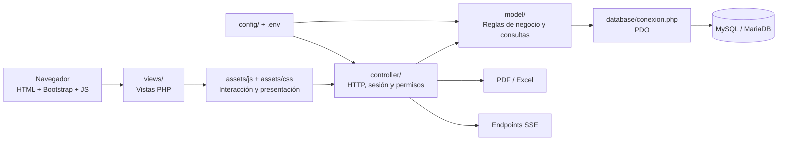
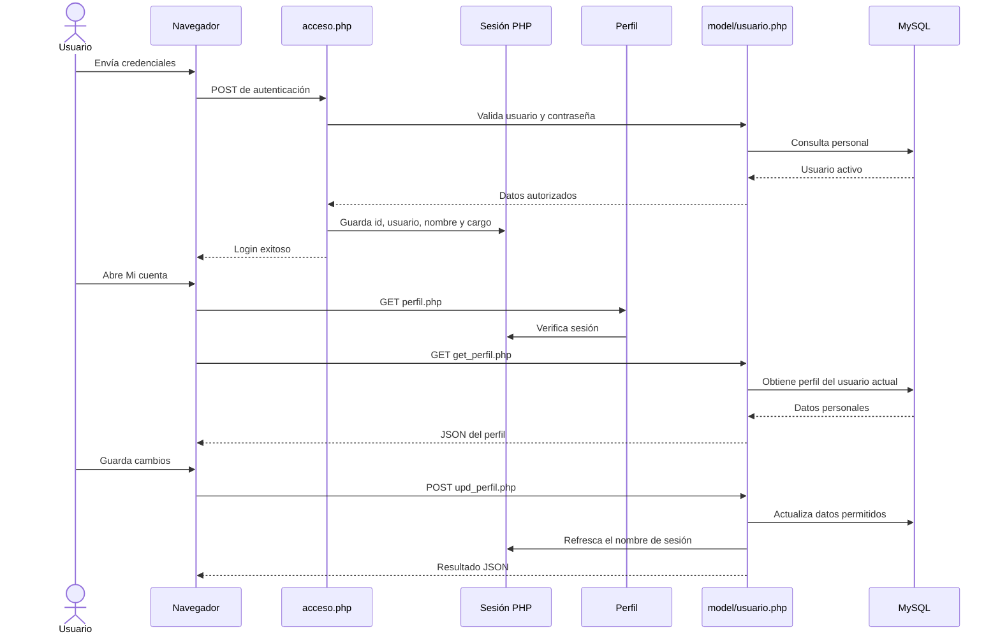
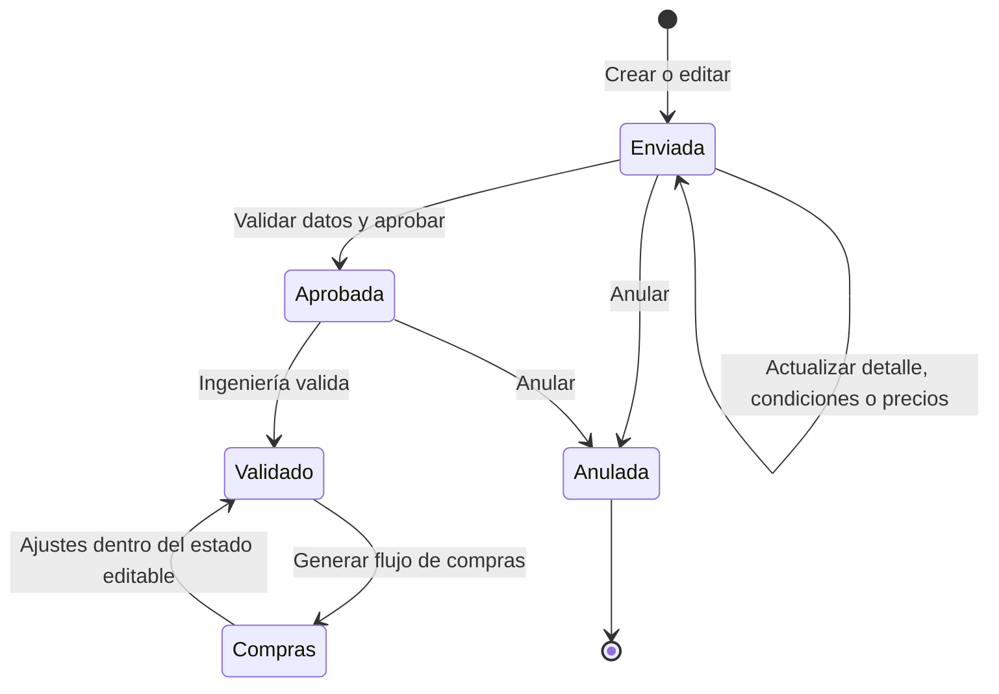
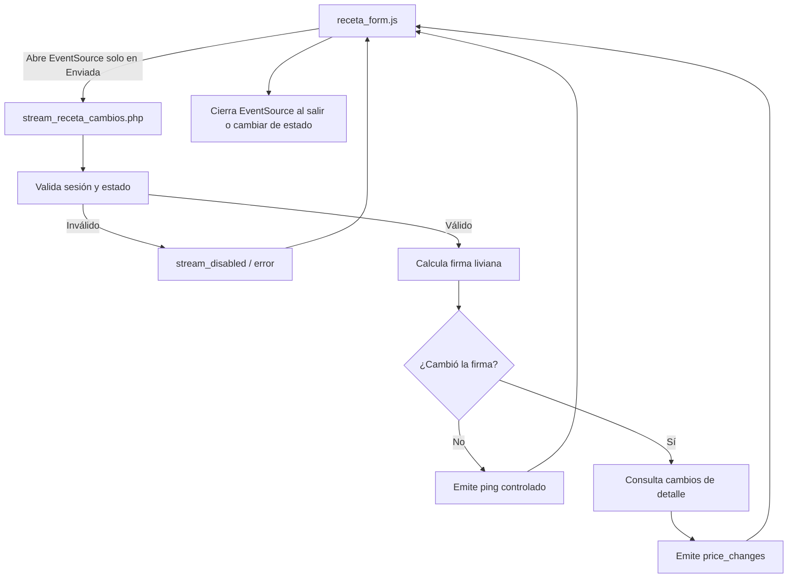

# Cotix360

[](https://forthebadge.com)
[](https://www.linkedin.com/in/drphp/)

[](https://www.youtube.com/watch?v=QzPLElgIzGA)

[](https://www.youtube.com/watch?v=QzPLElgIzGA)

## Descripción

Cotix360 es una aplicación web interna para gestionar el ciclo comercial y técnico de una
operación: usuarios, catálogo de ítems, cotizaciones, recetas comerciales, ingeniería y
compras. El sistema mantiene trazabilidad sobre precios, monedas, márgenes, estados,
aprobaciones y costos de compra.

La aplicación usa PHP server-rendered, JavaScript vanilla modular y una arquitectura
pragmática por capas. No depende de un framework MVC completo; cada módulo conserva sus
vistas, endpoints, modelos y assets específicos, con reglas compartidas documentadas en
`.ia-context/`.

## Funcionalidades

- Autenticación, sesiones, presencia y permisos por cargo.
- Perfil del usuario mediante **Mi cuenta**:
  - edición de nombres, apellidos, correo, teléfono y sexo;
  - cambio de contraseña con validación de la contraseña actual;
  - cargo, estado, documento y usuario protegidos contra cambios desde el perfil.
- Configuración visual mediante **Settings**:
  - tema claro/oscuro;
  - color de barra superior y menú;
  - tamaño del menú lateral;
  - restauración de la configuración por defecto.
- Administración de ítems y carga masiva desde Excel.
- Cotizaciones con cálculo de costos, financiamiento, precios finales y exportación PDF.
- Recetas comerciales con detalle editable, categorías, márgenes, monedas y tipo de cambio.
- Detección de cambios de precio mediante Server-Sent Events (SSE).
- Aprobación y transferencia de recetas hacia ingeniería.
- Ingeniería con validación técnica y adicionales positivos/negativos.
- Compras derivadas de ingeniería validada, con semáforo comparativo y gráficos.
- Exportaciones PDF y Excel para documentos comerciales y técnicos.

El dashboard calcula la variación de los cards de usuarios, ítems, cotizaciones, cargas,
recetas, ítems de receta, productos y servicios
según el rango seleccionado en el calendario. La comparación se realiza contra el período
inmediatamente anterior de igual duración. El valor inicial es el mes actual hasta hoy y el
selector permite analizar otros rangos sin recargar la página.

## Stack tecnológico

| Área | Tecnología |
| --- | --- |
| Backend | PHP 8.1+ |
| Servidor | Apache HTTP Server |
| Base de datos | MySQL 5.7+ o MariaDB |
| Acceso a datos | PDO |
| Frontend | HTML/PHP, JavaScript vanilla y Bootstrap |
| Tablas | Grid.js y componentes existentes del template |
| PDF | Dompdf |
| Excel | PhpSpreadsheet |
| Configuración | `vlucas/phpdotenv` |
| Tiempo real | Server-Sent Events |

## Arquitectura



### Responsabilidades por capa

- `views/`: estructura HTML/PHP, datos `data-*` y referencias a assets.
- `assets/js/`: comportamiento de pantalla, `fetch`, renderizado y validaciones UX.
- `assets/css/`: estilos específicos de módulos y documentos.
- `controller/`: método HTTP, sesión, autorización, validación de payload y respuesta.
- `model/`: consultas preparadas, transacciones y reglas persistentes del dominio.
- `database/`: conexión PDO y migraciones SQL versionadas.
- `config/`: bootstrap, permisos, APIs externas y configuración común.
- `layout/`: shell compartido, navegación, tema y footer.
- `release-notes/`: cambios funcionales relevantes para operación.
- `.ia-context/`: estándares de backend, frontend, base de datos y cálculos.

## Flujo de autenticación y perfil



## Flujos de negocio

### Cotizaciones

Una cotización combina ítems del catálogo con flete, gastos, financiamiento, factor y
precios finales. Los cálculos de backend son la fuente de verdad y deben coincidir con
la interfaz y el PDF generado.

### Recetas

Una receta es una propuesta comercial editable antes de su aprobación. Su flujo requiere:

1. Crear la cabecera y el detalle.
2. Completar datos del cliente y condiciones comerciales.
3. Definir márgenes por categoría.
4. Verificar precios, monedas y tipo de cambio.
5. Aprobar solo si las validaciones de negocio se cumplen.
6. Transferir a ingeniería para validación técnica.



Reglas esenciales:

- La receta solo es editable y recargable en estado `Enviada`.
- Los márgenes deben estar entre `0` y `100`.
- No se permite calcular con un margen decimal mayor o igual a `1`.
- Los precios en cero y los datos comerciales incompletos bloquean la aprobación.
- El frontend informa el estado, pero el backend decide autorización y persistencia.

### Ingeniería y compras

Ingeniería recibe una receta aprobada, valida el detalle técnico y administra adicionales.
Compras se genera desde ingeniería validada y compara su total contra la referencia técnica.

En compras:

- los ítems normales suman al total y al semáforo;
- los adicionales negativos descuentan del total y afectan el semáforo;
- los adicionales positivos son informativos y no afectan total ni semáforo.

## Cálculos y monedas

Para una línea `i`, con cantidad `q_i`, precio en soles `pS_i`, precio en dólares `pD_i`
y tipo de cambio `tc`:

```text
total_items   = Σ q_i
total_soles   = Σ (q_i × pS_i)
total_dolares = Σ (q_i × pD_i)
total_peru    = total_soles + (total_dolares × tc)
```

- Los montos se conservan con precisión interna y se redondean solo al presentar.
- Soles y dólares se muestran con 2 decimales.
- El tipo de cambio se muestra con 3 decimales.
- Si un ítem solo tiene precio en dólares, su equivalente en soles es `pD_i × tc`.
- Las fórmulas completas están en [`.ia-context/CALCULO_VARIABLES.md`](.ia-context/CALCULO_VARIABLES.md).

## Roles y autorización

Los roles principales se definen en [`config/permisos.json`](config/permisos.json):

| Cargo | Rol | Alcance |
| ---: | --- | --- |
| 1 | Administrador | Acceso completo |
| 2 | Gestor | Cotizaciones y cálculo |
| 3 | Supervisor | Operación comercial, ingeniería y compras |
| 4 | Técnico | Recetas e ingeniería sin precios ni totales sensibles |
| 5 | Compras | Compras, cotizaciones y recetas |
| 6 | Ingeniería | Ingeniería y recetas |
| 7 | Vendedor | Recetas comerciales |
| 8 | Coordinador | Operación coordinada de compras e ingeniería |

La autorización debe validarse en backend mediante la sesión y `session_cargo`. Ocultar
un botón o una columna en la interfaz nunca reemplaza la autorización del endpoint.

## Endpoints relevantes

### Sesión y cuenta

- `controller/acceso.php`: autenticación.
- `controller/logout.php`: cierre de sesión.
- `controller/dashboard_variaciones.php`: variaciones del dashboard según el rango seleccionado.
- `controller/get_perfil.php`: consulta el perfil del usuario autenticado.
- `controller/upd_perfil.php`: actualiza datos permitidos y contraseña.
- `controller/presence_ping.php`: actualiza presencia.

### Recetas

- `controller/table_receta.php`
- `controller/get_receta.php`
- `controller/add_receta.php`
- `controller/upd_receta.php`
- `controller/upd_estado_receta.php`
- `controller/get_receta_categoria.php`
- `controller/upd_receta_categoria.php`
- `controller/reload_receta_precios.php`
- `controller/stream_receta_cambios.php`

### Ingeniería

- `controller/aprobar_ingenieria.php`
- `controller/guardar_ingenieria.php`
- `controller/upd_ingenieria_detalle.php`
- `controller/upd_ingenieria_header.php`

### Compras

- `controller/compras/table_compras.php`
- `controller/compras/get_compra.php`
- `controller/compras/upd_compra_detalle.php`
- `controller/compras/charts_compra.php`

### Exportaciones

- `views/pdf_cotizacion.php`
- `views/pdf_receta.php`
- `controller/export_receta_excel.php`
- `controller/export_oferta_comercial_excel.php`

## Tiempo real con SSE

El módulo de recetas utiliza SSE para notificar cambios de precio del catálogo.



Requisitos operativos:

- declarar `Content-Type: text/event-stream; charset=utf-8`;
- validar sesión antes de iniciar el stream;
- ejecutar `session_write_close()` después de autenticar;
- usar conteos, checksums o firmas antes de consultar el detalle completo;
- emitir `price_changes`, `ping`, `stream_disabled` y `error`;
- cortar conexiones largas para permitir reconexión limpia.

## Instalación local

### Requisitos

- PHP 8.1 o superior con extensiones requeridas por Composer.
- Composer.
- Apache con `mod_rewrite` habilitado.
- MySQL 5.7+ o MariaDB.
- Node.js únicamente si se necesita validar JavaScript localmente.

### Pasos

1. Instalar dependencias:

   ```bash
   composer install
   ```

2. Crear `.env` en la raíz:

   ```env
   DB_HOST=127.0.0.1
   DB_NAME=bd_cotix
   DB_USER=root
   DB_PASS=

   IP_API_URL=https://api.ipify.org
   API_DNI_URL=
   API_DNI_URL_2=
   API_RUC_URL=
   API_RUC_URL_2=
   ```

3. Crear la base de datos y aplicar las migraciones de
   [`database/migrations/`](database/migrations/), además del dump/base inicial del entorno.
4. Publicar el proyecto en Apache, por ejemplo:

   ```text
   C:\Apache24\htdocs\cotix
   ```

5. Abrir:

   ```text
   http://127.0.0.1/cotix/index.php
   ```

Nunca versionar credenciales reales, tokens ni archivos `.env`.

## Migraciones y datos

Toda modificación de esquema debe tener una migración SQL con formato:

```text
database/migrations/YYYY-MM-DD_descripcion.sql
```

Antes de desplegar código dependiente de una migración:

1. respaldar la base de datos cuando corresponda;
2. revisar compatibilidad con datos históricos;
3. ejecutar la migración en el ambiente objetivo;
4. validar índices, valores por defecto y estados;
5. probar los endpoints que consumen las columnas modificadas.

Las migraciones deben ser explícitas aunque algunos modelos incorporen creación defensiva
para compatibilidad con ambientes existentes.

## Desarrollo y calidad

Comandos de validación habituales:

```bash
composer install
php -l controller/compras/get_compra.php
php -l model/compras/compras.php
node --check assets/js/compras_detalle.js
```

Checklist antes de cerrar un cambio:

- [ ] No se agregó JavaScript ni CSS inline.
- [ ] Las vistas solo contienen estructura y referencias a assets.
- [ ] El endpoint valida método HTTP, sesión, permisos y payload.
- [ ] Las consultas usan PDO preparado.
- [ ] Las operaciones compuestas usan transacciones y rollback.
- [ ] Las reglas críticas se validan en frontend y backend.
- [ ] Los cálculos coinciden entre UI, backend y PDF/Excel.
- [ ] Los cambios de esquema tienen migración.
- [ ] Los assets modificados tienen cache bust actualizado.
- [ ] Los streams SSE liberan la sesión y manejan reconexión.
- [ ] La documentación funcional y las release notes fueron actualizadas si aplica.

## Troubleshooting

| Síntoma | Revisión inicial |
| --- | --- |
| Error de conexión | `.env`, credenciales, host, base y permisos MySQL |
| Login rechazado | usuario activo, contraseña, sesión PHP y `session_cargo` |
| Perfil no carga | sesión vigente, permisos de `perfil.php` y respuesta JSON |
| Cambios JS no aparecen | `Ctrl + F5` y versión `?v=` del asset |
| PDF no genera | `vendor/`, Dompdf y permisos temporales |
| Excel no carga | cabeceras, formato, tamaño y columnas esperadas |
| SSE no notifica | estado `Enviada`, conexión del navegador y endpoint SSE |
| Migración falla | respaldo, versión MySQL, SQL y datos históricos |

## Riesgos técnicos conocidos

- Reglas financieras distribuidas entre PHP y JavaScript.
- Estados de negocio representados como strings y enums SQL.
- Dependencia de cache bust manual para assets.
- Consultas complejas con agregaciones que requieren revisión de rendimiento.
- Compatibilidad con datos históricos y ambientes con migraciones parciales.

Al modificar totales, márgenes, estados, permisos o exportaciones, validar el flujo completo:
lista, detalle, actualización AJAX, transición de estado y documento generado.

## Documentación del proyecto

- [`.ia-context/AGENTS_ROLES.md`](.ia-context/AGENTS_ROLES.md)
- [`.ia-context/BACKEND_STANDARDS.md`](.ia-context/BACKEND_STANDARDS.md)
- [`.ia-context/FRONTEND_STANDARDS.md`](.ia-context/FRONTEND_STANDARDS.md)
- [`.ia-context/DATABASE_STANDARDS.md`](.ia-context/DATABASE_STANDARDS.md)
- [`.ia-context/REGLAS_DESARROLLO.md`](.ia-context/REGLAS_DESARROLLO.md)
- [`.ia-context/CALCULO_VARIABLES.md`](.ia-context/CALCULO_VARIABLES.md)
- [`release-notes/`](release-notes/)

## Licencia

Proyecto de uso interno. Definir una licencia explícita antes de distribuirlo a terceros.
